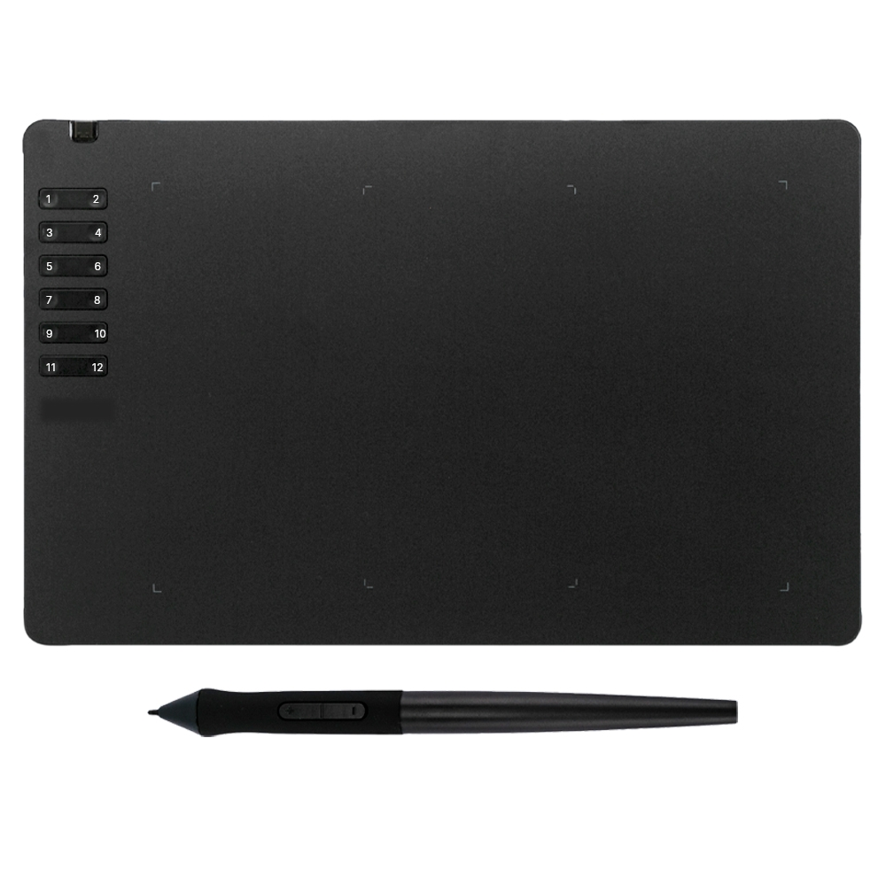

# Gadnic Magic Draw Linux User-Space Driver

This README provides information about the Linux user-space driver 
for the graphics tablet sold in Argentina as the Gadnic Magic Draw (model GRF785).

The driver supports various rebranded versions of the same device, 
but this particular version has been tweaked specifically
for the Magic Draw tablet.

## Changes

The pressure sensitivity calibration has been adjusted so the pen works correctly while drawing.
The tablet buttons are documented below so they can be remapped to your liking:

```rust
fn normalize_pressure(raw_pressure: i32) -> i32 {
    let proximity_threshold = 250; // Adjust for proximity sensitivity
    let strength_scaling = 8; // Adjust for strength of the press

    match 1740 - raw_pressure {
        x if x <= proximity_threshold => 0,
        x => x * strength_scaling, // Scale the pressure for stronger presses
    }
}
```

Further improvements may be added as the tablet is tested more thoroughly or as users contribute enhancements.

## Supported Devices

This driver is intended for use with the following devices:
- Gadnic Magic Draw GRF785


## Features

- Utilizes the tablet's full active area.
- All 12 physical buttons are functional.
- Both stylus buttons are operational.
- Supports about 700 levels of pressure sensitivity.
While the device is marketed with 8192 levels, the hardware only 
reports 1024, of which roughly 700 are usable without risking 
damage to the stylus.

## Installation

To build the driver, follow these steps:

> **Note:** You will need [Rust](https://wiki.archlinux.org/title/rust) installed.

```bash
git clone git@github.com:vlank/gadnic_magic_draw_grf785_linux_driver.git
cd gadnic_magic_draw_grf785_linux_driver
cargo build --release
```

The driver will be located in `target/release/gadnic_magic_draw`.

## Usage

To run the driver, you have two options:

1. **Run as Root:**

   ```bash
   sudo ./gadnic_magic_draw
   ```

2. **Create a udev Rule:**

   For Fedora/Nobara Linux (this may vary by distribution):

   ```bash
   sudo tee /etc/udev/rules.d/99-gadnic_magic_draw.rules << 'EOF'
     SUBSYSTEM=="usb", ATTR{idVendor}=="08f2", ATTR{idProduct}=="6811", MODE="0666"
     SUBSYSTEM=="input", GROUP="input", MODE="0666"
     KERNEL=="uinput", MODE="0666", GROUP="input"
     EOF
   sudo udevadm control --reload-rules
   sudo udevadm trigger
   ```

   This allows any user to run the driver without needing sudo.

## Automatic Startup

After a shutdown or restart, the driver must be started manually. 
To make the tablet work automatically on login, 
the recommended approach is to create a systemd user service.

1. Create the service file

   ```bash
   mkdir -p ~/.config/systemd/user
   nano ~/.config/systemd/user/gadnic_magic_draw.service
   ```

2. Paste this content (replace **user** with your username if it's different):

   ```ini
   [Unit]
   Description=Gadnic Magic Draw Graphics Tablet Driver
   After=graphical-session.target
   
   [Service]
   ExecStart=/home/user/gadnic_magic_draw_grf785_linux_driver/target/release/gadnic_magic_draw
   Restart=on-failure
   RestartSec=2
   
   [Install]
   WantedBy=default.target
   ```
3. Enable it

   ```bash
   systemctl --user daemon-reload
   systemctl --user enable --now gadnic_magic_draw.service
   ```

This will make the driver start automatically every time you log in. 
You can check its status with `systemctl --user status gadnic_magic_draw.service`.

## Customizing Keymaps


The driver maps each physical tablet button to a virtual key or key 
combination, which is defined in the keymap inside the source code in
`src/virtual_device.rs`.
The keymap is a list of tuples, where each entry associates a **button ID** with a sequence of keys to emit:

```rust
(6, vec![Key::KEY_LEFTBRACE]),
```

In this example, **button ID 6** emits `KEY_LEFTBRACE`. You can change the emitted keys to whatever you like — a single key or a combination.

> On Linux, **X11 keycodes are calculated as `evdev code + 8`**. So if a button emits `KEY_LEFTBRACE` (evdev code `26`), the resulting X11 keycode is `34`. On a Spanish keyboard layout, that keycode corresponds to `dead_acute` (´).


### Modifying a Keymap Entry

To change the behavior of a button, edit its line in the keymap. For example, to map button ID 6 to `Ctrl+Z` (undo):

```rust
(6, vec![Key::KEY_LEFTCTRL, Key::KEY_Z]), // 5
```

Or to a single key like `Escape`:

```rust
(6, vec![Key::KEY_ESC]), // 5
```

After editing the keymap, recompile the driver and restart the service:

```bash
cd ~/gadnic_magic_draw_grf785_linux_driver
cargo build --release
systemctl --user restart gadnic_magic_draw.service
```


## References

- [Tool that enables expanded mode for the tablet, by DigiMend](https://github.com/DIGImend/10moons-tools)
- [Learning about the possibility of creating user-space drivers](https://github.com/alex-s-v/10moons-driver)
- [Marvin's work](https://github.com/marvinbelfort/mx002_linux_driver)
- [Paulo Carvalho post](https://krita-artists.org/t/solution-to-gotop-vinsa-t505-linux-driver/163760)